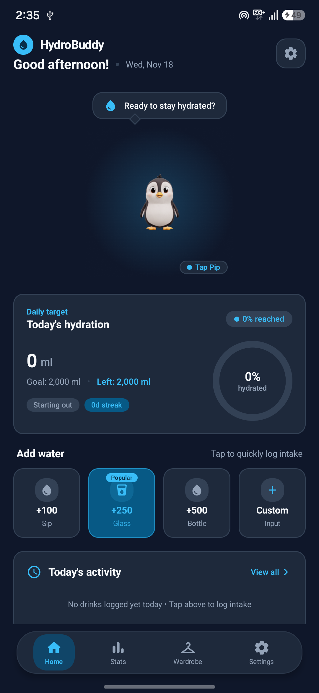
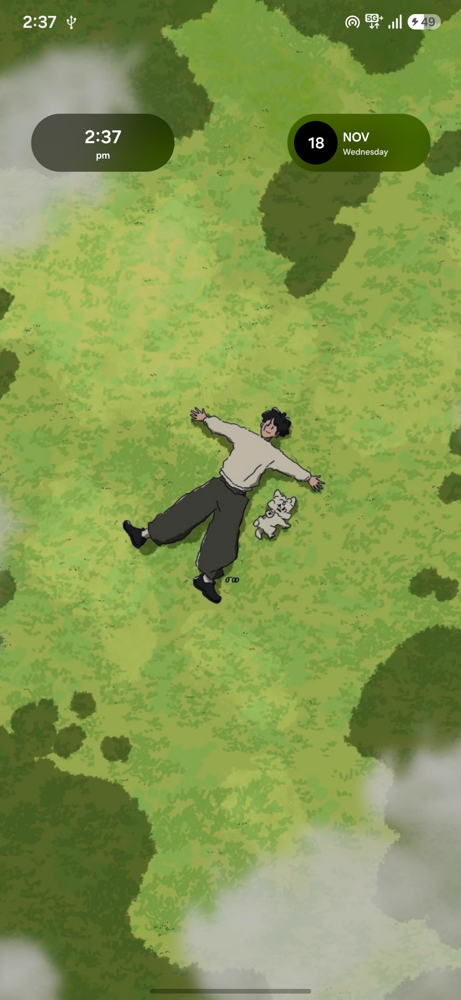
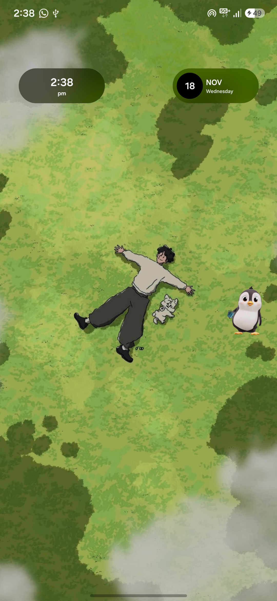
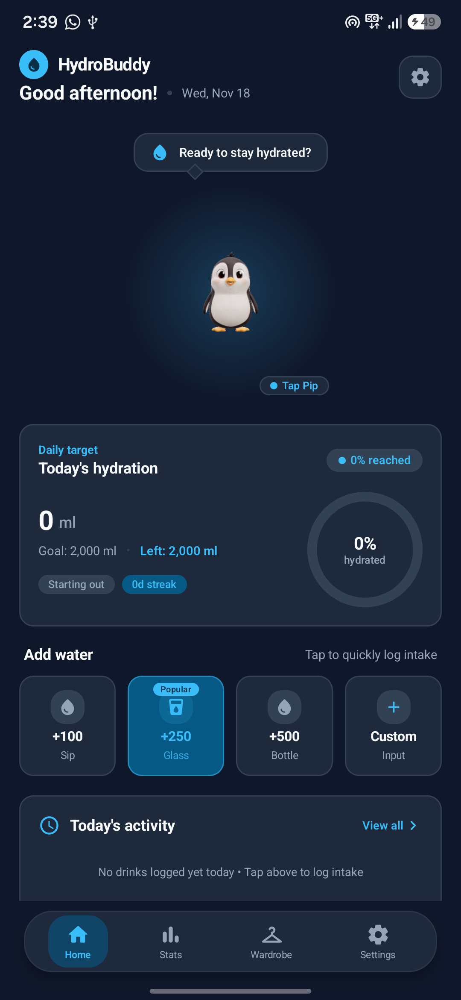

# HydroBuddy 💧

> **A playful, smart hydration tracker powered by a real-time 3D droplet buddy named Pip.**

HydroBuddy helps you build consistent daily drinking habits. Pip waddles onto your screen when you need a reminder, reacts in 3D to every glass you log, and tracks your hydration rhythm across days and weeks.

---

## Screenshots

| Home (3D Pip) | Walk-in Reminder | Floating Overlay | Settings & Schedule |
|:---:|:---:|:---:|:---:|
|  |  |  |  |

---

## Features

- **Interactive 3D Mascot (Pip)**:
  - Rendered with Google Filament and SceneView 2.2.1.
  - Interactive touch rotation with inertia and automatic return to front.
  - Expressive character animations: breathing idle, drinking celebration, waddling walk-in, and sad reactions.
  - Customizable size slider (50% to 150%) scaled across all surfaces.
  - Wardrobe system for accessories and custom personality types (Friendly, Sad, Rude).

- **Reliable Exact Alarm Reminder Engine**:
  - Zero background battery drain: no persistent foreground service while idle.
  - Driven by Android `AlarmManager.setExactAndAllowWhileIdle()`.
  - Configurable active hours (e.g. 08:00 to 22:00, including midnight-crossing windows) so you are never disturbed while sleeping.
  - Survives device reboots (`BOOT_COMPLETED`), timezone adjustments, and system clock changes.
  - "Remind me now" instant manual trigger with automatic next-alarm rescheduling.

- **System-Wide Floating Pip Overlay**:
  - When overlay permission is granted, Pip literally walks onto your screen over any active app when a reminder is due.
  - One-tap quick actions: Drink (+250 ml), Snooze, or Dismiss.
  - Falls back to high-priority heads-up notifications when overlay permission is disabled.

- **Hydration Rhythm & Stats**:
  - Local database storage of individual intake entries.
  - Daily goal tracking with ml / litres toggle.
  - 7-day rolling intake chart and hydration streak counter.
  - Instant intake logging (+250 ml, +500 ml) or custom amounts with undo support.

- **Theme & Performance Engineered**:
  - Supports Light theme, Dark theme, and System default with instant toggle.
  - Clean Material 3 design system with 8dp grid and zero decorative slop.
  - Android Baseline Profile enabled with fast ART startup compilation.
  - R8 minification and resource shrinking with strict Filament/SceneView keep rules.

---

## Technical Specifications & Requirements

- **Platform**: Android
- **Minimum SDK**: Android 8.0 (API Level 26)
- **Target SDK**: Android 15 (API Level 35)
- **Architecture**: 100% Kotlin, Jetpack Compose, MVVM Architecture
- **Rendering Engine**: Google Filament / SceneView 2.2.1
- **Storage**: Jetpack DataStore Preferences & SQLite OpenHelper
- **Build Toolchain**: Gradle 8.14, Kotlin 2.0+, Android Gradle Plugin 8.8+
- **JDK Requirement**: Java 21 (JDK 21)

---

## Permissions

HydroBuddy requests only the minimum permissions necessary for scheduling and overlays:

| Permission | Purpose |
|:---|:---|
| `POST_NOTIFICATIONS` | Delivers hydration reminder notifications on Android 13+. |
| `SCHEDULE_EXACT_ALARM` | Ensures timely hydration prompts without battery-draining polling. |
| `SYSTEM_ALERT_WINDOW` | Enables Pip to float/walk over other apps when reminders trigger (optional, user-granted). |
| `RECEIVE_BOOT_COMPLETED` | Restores scheduled alarms automatically after device restart. |
| `VIBRATE` | Gentle haptic feedback on reminder triggers. |

---

## Building from Source

### Prerequisites
1. Android Studio Ladybug (2024.2+) or later.
2. JDK 21 installed and configured in `JAVA_HOME`.
3. Android SDK platform 35 and build-tools 34.0.0+.

### Build Commands

```bash
# Clone the repository
git clone https://github.com/<your-username>/HydroBuddy.git
cd HydroBuddy

# Build Debug APK
./gradlew assembleDebug

# Build Signed Release APK
./gradlew assembleRelease
```

> [!NOTE]
> **Release Keystore Note**: The production release signing keystore (`keystore/hydrobuddy-release.jks`) and `keystore.properties` are private and intentionally excluded from version control. When building `assembleRelease` without a release keystore, Gradle automatically falls back to debug signing so that local release builds and CI pipelines compile cleanly without configuration.

---

## Running on Device

```bash
# Install the build
adb install -r app/build/outputs/apk/release/app-release.apk

# Launch MainActivity
adb shell am start -n com.hydrobuddy.app/.MainActivity
```

---

## Asset Credits

All 3D models, textures, animations, and sprite sheets were custom designed for HydroBuddy. For details on sources, tools, and attributions, see [ASSETS.md](ASSETS.md).

---

## License

This project is licensed under the terms of the project [LICENSE](LICENSE).
